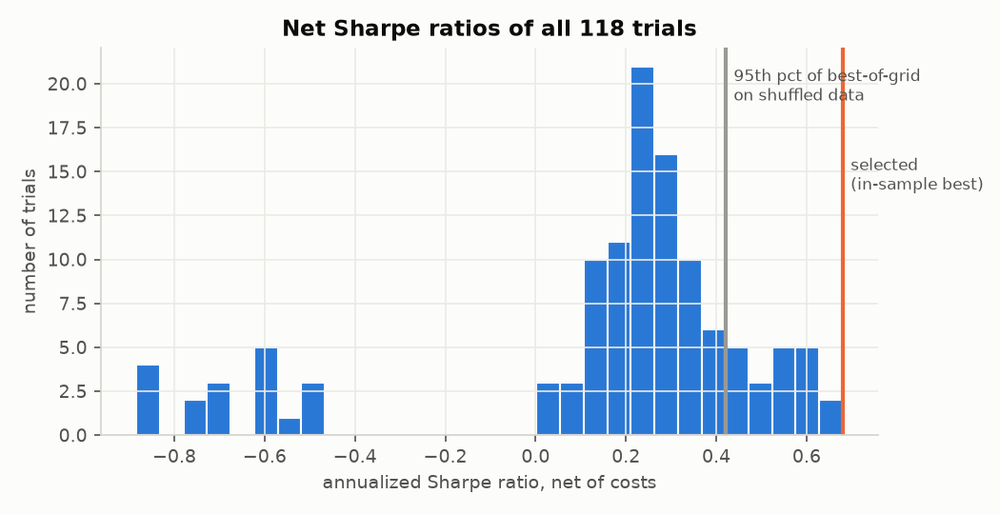
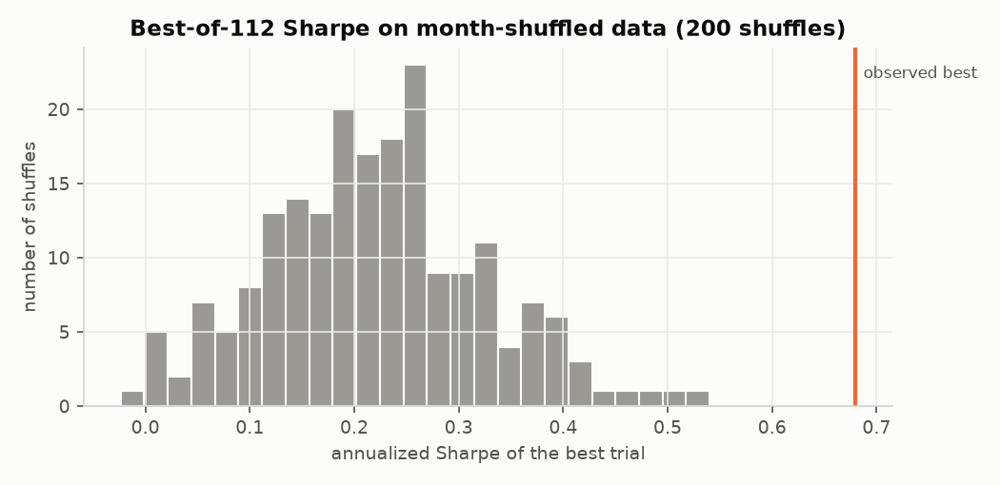
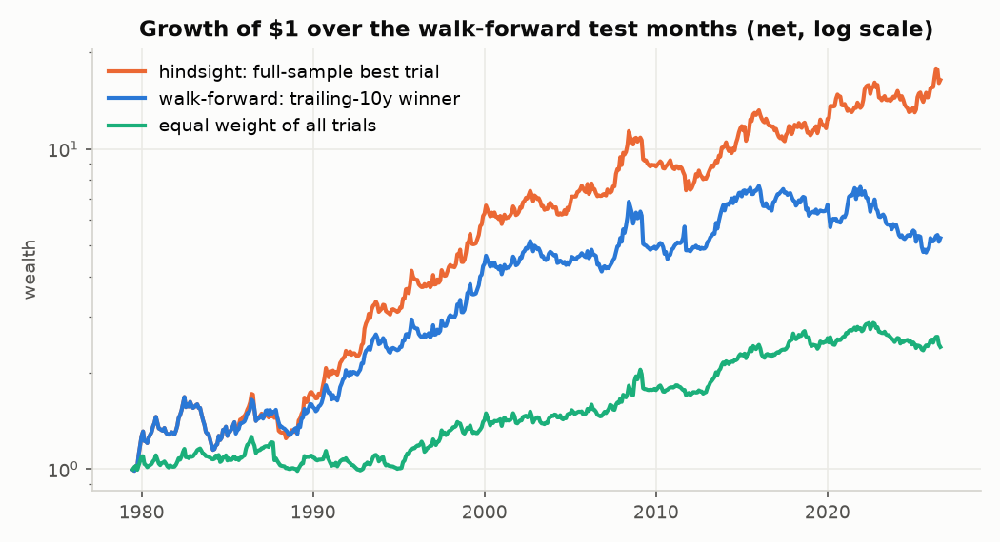
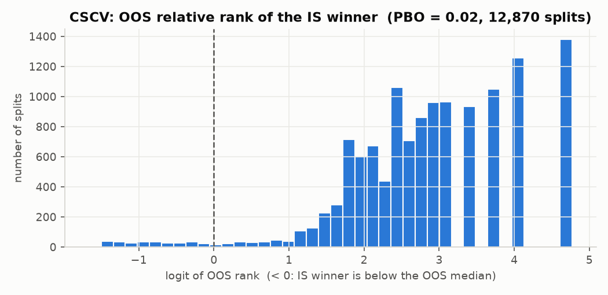
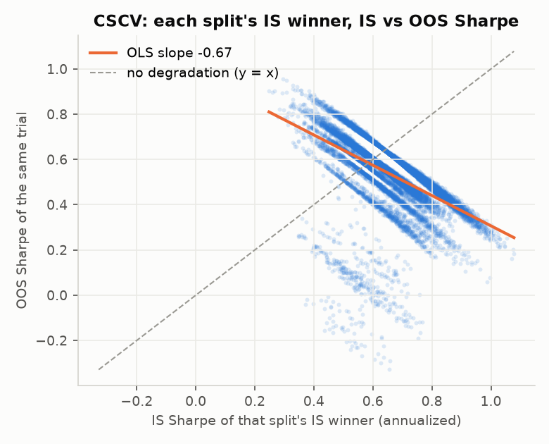

# backtest-overfit

How much of a good backtest is luck? This repo backtests 112 parameterizations of four
textbook strategy families (time-series momentum, cross-sectional momentum, short-term
reversal, moving-average crossovers) on the 49 Kenneth French industry portfolios,
picks the best one, and then runs the standard overfitting diagnostics on that choice:
walk-forward selection, Combinatorially Symmetric Cross-Validation (Probability of
Backtest Overfitting), the Deflated Sharpe Ratio, a month-shuffling permutation null,
block-bootstrap confidence intervals, and Fama-French alphas with Newey-West t-stats.
The goal is a direct comparison between the Sharpe ratio a backtest reports and the one
you should expect to get.

Report page: https://adleraaa.github.io/backtest-overfit/

## Finding

The backtest winner is industry momentum (12-month lookback, top/bottom 20%, 12-month
volatility window), with a net Sharpe ratio of 0.68 over 1969-07 to 2026-08. The grid's best
Sharpe is far above what the same grid finds on month-shuffled data: there the best of the
112 trials averaged 0.22 and reached at most 0.54 in 200 shuffles
(p = 0.005). Shuffling also destroys the volatility clustering that volatility
targeting uses, so part of the 0.68 is vol timing: without it the same signal earns
0.52 (still the best of the 56 unscaled signals), against a shuffled
best-of-56 mean of 0.20 and max of 0.50 (p = 0.005).
PBO is 0.024. This rules out "no time-series
predictability at all"; it does not show the effect is new (industry momentum was
published in 1999). The *size* of the Sharpe ratio is inflated by selection: the same
selection rule run walk-forward (pick the trailing 10-year winner each year) earned
0.36 pseudo out-of-sample, against 0.57 for the hindsight winner over the same
months, and the winner's own Sharpe fell from 0.90 in the first half of the sample to
0.46 in the second. The Deflated Sharpe Ratio is 0.89 with sign-aligned families and
all 112 trials counted as independent, a conservative choice (see Design decisions). The
literal paper recipe gives 0.049, mostly because the losing reversal family, which is
sign-flipped momentum, is counted as spread between trials.

## Results

All numbers come from `results/summary.json`, `results/trials.csv` and
`results/walk_forward_selections.csv`, written by `scripts/run_experiment.py` with its
default settings. Returns are monthly and net of 10 bps per unit of turnover. Every
trial is scaled to a 10% annualized volatility target unless stated otherwise. The
evaluation window is 686 months (1969-07 to 2026-08), and data from 1963-07 onward is
used as signal warm-up. Data vintage: "202608 CRSP database" (the sha256 of each
downloaded zip is in `summary.json["meta"]`; the library revises history monthly, so a
later download gives slightly different numbers). The full run (200 permutations)
took 899 s on an Intel i9-14900HX laptop (CPU only).

**Selected strategy vs. what to expect**

| Measure | Value |
|---|---|
| Selected trial | `xsmom(lookback=12,skip=0,quantile=0.2)\|vol12` |
| Net Sharpe, full sample (in-sample) | 0.68 (95% block-bootstrap CI 0.41 to 0.95, conditional on this trial; not a post-selection interval) |
| Ann. return / vol / max drawdown | 8.1% / 11.9% / -34.7% |
| Sharpe 1969-07 to 1998-01 / 1998-02 to 2026-08 | 0.90 / 0.46 |
| Best-of-grid Sharpe on shuffled months: mean / 95th pct / max (200 shuffles) | 0.22 / 0.39 / 0.54 |
| Permutation p-value | 0.005 |
| Same signal without vol targeting | 0.52 |
| Best-of-56 unscaled signals on shuffled months: mean / 95th pct / max | 0.20 / 0.35 / 0.50 (p = 0.005) |
| PBO (CSCV, 16 blocks, 12,870 splits) | 0.024 |
| CSCV median Sharpe of the IS winner: IS / OOS | 0.66 / 0.54 |
| Walk-forward OOS Sharpe (10y train, 1y test, 566 months) | 0.36 (95% CI 0.05 to 0.68) |
| Hindsight winner over the same 566 months | 0.57 |
| Equal weight of all 112 trials, same months | 0.30 |
| Probabilistic Sharpe Ratio vs 0 | 1.000 |

**Deflated Sharpe Ratio under different Var[SR] and N**

| Var[SR] from | N | Std of trial SR (ann.) | E[max SR] (ann.) | DSR |
|---|---|---|---|---|
| Raw trial Sharpes (paper recipe) | 112.0 | 0.35 | 0.90 | 0.049 |
| Sign-aligned families (headline) | 112.0 | 0.20 | 0.51 | 0.893 |
| Sign-aligned, effective N | 3.1 | 0.20 | 0.18 | 1.000 |
| No-signal variance from shuffles | 112.0 | 0.13 | 0.34 | 0.994 |

**Alpha (OLS, Newey-West t-stats, 6 lags for the full sample and 5 for walk-forward)**

| Series | FF3 alpha / yr | t | FF5 alpha / yr | t |
|---|---|---|---|---|
| Selected (hindsight) | 9.6% | 5.66 | 9.5% | 5.17 |
| Walk-forward OOS | 4.4% | 2.46 | 3.8% | 2.04 |

**By family** (PBO computed within the family only)

| Family | Trials | Best Sharpe | Median Sharpe | PBO |
|---|---|---|---|---|
| Cross-sectional momentum | 48 | 0.68 | 0.38 | 0.02 |
| Time-series momentum | 14 | 0.39 | 0.21 | 0.32 |
| Moving-average crossover | 38 | 0.36 | 0.22 | 0.34 |
| Short-term reversal | 12 | -0.52 | -0.74 | 0.01 |

Other results:

- Transaction costs: the selected trial's Sharpe is 0.76 at 0 bps, 0.68 at 10 bps, 0.56 at 25 bps and 0.37 at 50 bps.
- Deflated Sharpe with the sign-aligned variance, as a function of the number of trials
  N: 1.000 (N=1), 1.000 (N=4), 0.997 (N=10), 0.976 (N=30), 0.893 (N=112).
- The largest absolute correlation between any two trials is 0.98
  (`selected.max_abs_corr_between_trials`).
- Industry "reversal" loses money in every variant (Sharpe -0.52 to -0.88).
  At the industry level, the recent-return effect is continuation, the opposite of the
  one-month reversal known for individual stocks. This matches Moskowitz and Grinblatt
  (1999).
- Walk-forward picked 18 distinct trials across 48 windows: cross-sectional momentum 75%, moving-average crossover 23%, time-series momentum 2%.







In the last figure each point is one CSCV split: the IS Sharpe of that split's IS winner
(which changes from split to split) against its OOS Sharpe. The OLS slope is -0.67
(`pbo.is_oos_slope`). This is partly mechanical in CSCV: the in-sample and out-of-sample
halves are complements of one fixed sample, so a trial that looks unusually good in one
half must look worse in the other.

## Architecture

```
data.py        download + cache French library zips (checked to be zips), parse table
   |
strategies.py  returns (T x N) -> target weights; row t uses data up to t only
   |
backtest.py    hold weights of t during t+1; vol targeting; costs on turnover
   |
grid.py        56 signal specs x 2 vol windows = 112 trials (no mirror-image pairs)
   |
study.py       run grid -> trial return matrix -> select in-sample best, then:
   |             metrics.py  Sharpe, PSR, DSR, E[max SR], effective N, block bootstrap CI
   |             overfit.py  CSCV/PBO, walk-forward selection
   |             factors.py  FF3/FF5 alpha, Newey-West
   |             permutation null (grid re-run on data with evaluation months shuffled),
   |             repeated for the 56 signals without vol targeting
   |
plots.py / report.py   PNG figures, static HTML report for GitHub Pages
```

## Quickstart / Reproduce

```bash
python -m venv .venv
source .venv/bin/activate          # Windows: .venv\Scripts\activate
pip install -e ".[dev]"

pytest                             # 116 tests, synthetic data only, no network
ruff check . && ruff format --check .

python scripts/run_experiment.py   # downloads ~0.5 MB into data/raw/, writes results/
python -m btoverfit.report         # builds site/index.html from results/
```

The default of 200 permutations is what the committed results use. `--permutations 20`
gives a faster run and changes only the permutation-null numbers and the null-variance
DSR. `--refresh` re-downloads the cached data files.

## Design decisions

- **Excess returns everywhere.** Industry returns minus the 1-month T-bill are used for
  both signals and P&L. Long-short and T-bill-funded positions are then on the same
  footing, and a Sharpe ratio is just mean/std.
- **Look-ahead is tested, not assumed.** `tests/test_no_lookahead.py` recomputes every
  grid signal on data truncated at month t and requires the same weights. A deliberately
  leaky signal is included to show that the check catches it. Another test uses an
  alternating return series, where a backtester without the one-month lag would show
  a perfect record.
- **No mirror trials, and a sign-aligned DSR.** An earlier version of the grid had
  `reversal(lookback=3)`, which ranks the negative of the same trailing return that
  `xsmom(lookback=3, skip=0)` ranks: identical turnover and exactly negated weights
  (`tests/test_grid.py` checks this). More broadly, the reversal family is sign-flipped
  short-horizon momentum. Counting a losing family as "spread" inflates the cross-trial
  Var[SR]: the results committed in c39caa1 had E[max SR] = 0.99 and DSR = 0.011, which
  was at first misread as DSR being unstable ("raw" row above: 0.049 now). The
  mirror lookback is now excluded (a test asserts no two signals are more than 0.99
  correlated), and the headline DSR flips families with a negative median Sharpe before
  taking the variance. It still counts all 112 trials as independent, which overstates N,
  so it errs low. The effective-N variant (participation ratio of the correlation
  eigenvalues, 3.1) errs high, because one momentum-like factor dominates the grid.
- **Month-shuffling null over the evaluation window only.** Permuting whole months keeps
  each month's cross-section and removes time-series structure. Only months from
  1969-07 on are shuffled: Hlth has no returns during the 1963-1969 warm-up, and moving
  those NaN rows into the window would drop it from many lookback windows, so the null
  would trade a different universe. Shuffling also removes the volatility clustering
  that vol targeting exploits, so the null is repeated without vol targeting.
- **Volatility targeting uses only past unscaled P&L.** Warm-up months are NaN, not
  zero. Zeros would shrink the volatility estimate and push every strategy to the
  leverage cap (5x gross). Only the leading warm-up is masked, so a flat month later on
  does not switch a strategy off for a whole volatility window.
- **CSCV from block sums.** Each of the 12,870 splits is a sum of per-block sums and
  sums of squares, so all splits cost two matrix products (derivation in the
  `cscv_pbo` docstring). A slow loop implementation in the tests checks it exactly.

## Limitations

- Transaction costs are a flat bps charge on turnover. They ignore weight drift within
  the month, borrowing costs for shorts, and the fact that industry portfolios are not
  directly tradable (an ETF implementation would have tracking error and fees).
- The grid (112 trials) is small and was chosen for this study. A real research process usually
  tries more variants, and those extra variants are never logged, which is exactly what
  PBO and DSR are meant to penalize. The reported DSR and PBO describe this grid only.
- Neither N for the DSR is right: all 112 trials overstates the number of independent
  ideas and the participation ratio (3.1) likely understates it. A clustering-based
  count (Lopez de Prado's ONC) would sit in between and is not implemented.
- The strategy families are well known and published. Selecting momentum in 2026 uses
  knowledge from after 1969, which no in-sample test can remove. The walk-forward result
  only removes the parameter-selection part of that look-ahead.
- The bootstrap CI assumes stationarity within 12-month blocks. The large drop between
  sample halves suggests the process is not stationary.
- The permutation p-value has a floor of 1/201 with 200 shuffles.
- The last walk-forward window is partial (2026-07 to 2026-08).

## Data

Kenneth R. French Data Library,
https://mba.tuck.dartmouth.edu/pages/faculty/ken.french/data_library.html
(49 Industry Portfolios, Fama/French 3 Factors, Fama/French 5 Factors (2x3); monthly,
value-weighted). The library does not publish a redistribution license, so no raw data
is committed. `src/btoverfit/data.py` downloads and caches the files, and only derived
statistics are committed under `results/`.

## References

- Bailey, D., Borwein, J., Lopez de Prado, M., Zhu, Q. (2017). The Probability of Backtest
  Overfitting. *Journal of Computational Finance* 20(4), 39-69 (SSRN working paper 2015).
- Bailey, D., Lopez de Prado, M. (2014). The Deflated Sharpe Ratio. *Journal of Portfolio
  Management* 40(5). `tests/test_metrics.py` reproduces its numerical example.
- Bailey, D., Lopez de Prado, M. (2012). The Sharpe Ratio Efficient Frontier. *Journal of
  Risk* 15(2).
- Moskowitz, T., Grinblatt, M. (1999). Do Industries Explain Momentum? *Journal of Finance*
  54(4).
- Newey, W., West, K. (1994). Automatic Lag Selection in Covariance Matrix Estimation.
  *Review of Economic Studies* 61(4).

## License

MIT, copyright 2026 Yunlong Lu. See [LICENSE](LICENSE).
